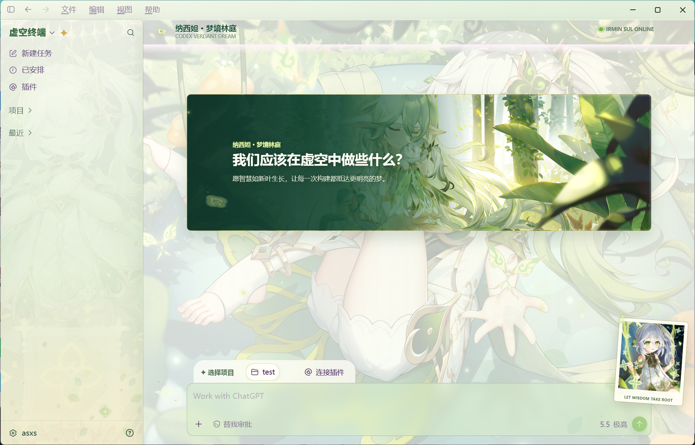
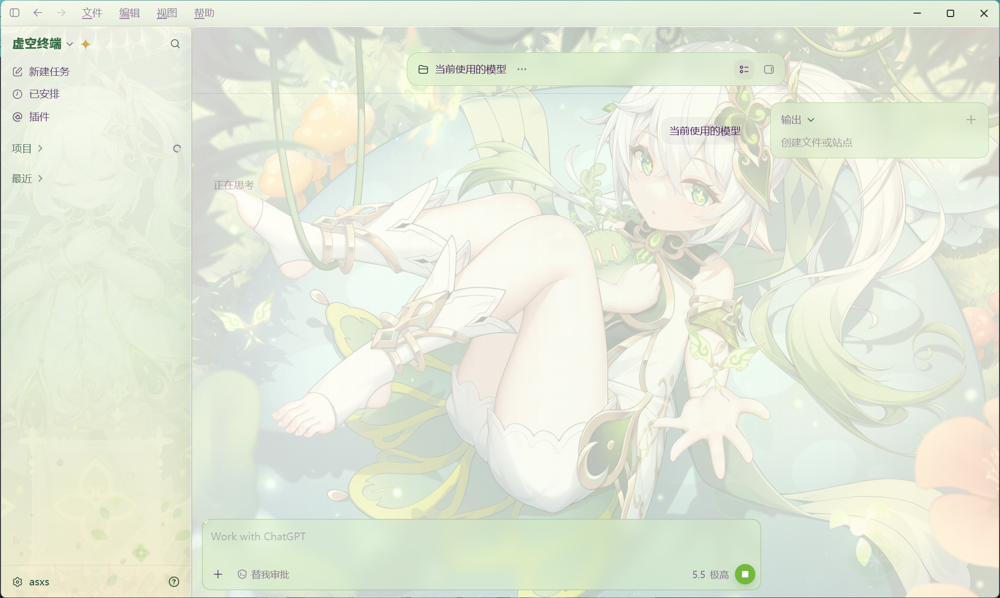
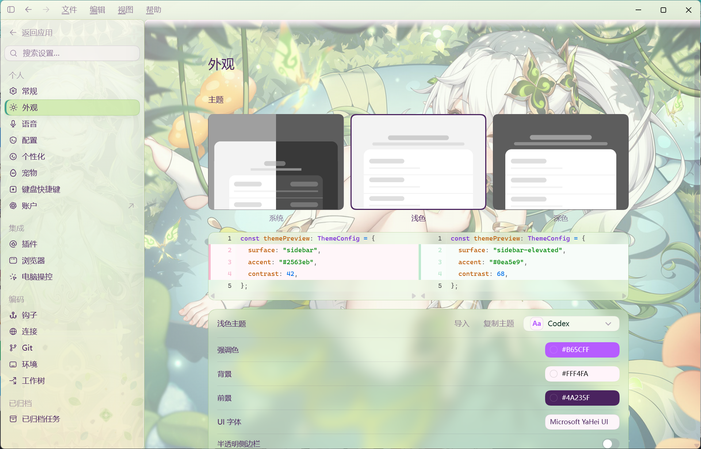

# Codex Dream Skin · Nahida

<p align="center">
  <strong>中文</strong> · <a href="./README.en.md">English</a>
</p>

<p align="center">
  <strong>为 Windows Codex 桌面端打造的纳西妲「梦境林庭」主题。</strong><br>
  分层主题资源 · 原生控件保留 · 本机回环 CDP 注入 · 随时恢复官方外观
</p>

<p align="center">
  
</p>

> [!IMPORTANT]
> 本项目仅支持 Windows，是非 OpenAI 官方的桌面端外观定制工具。它不会修改
> WindowsApps、`app.asar`、官方二进制、代码签名、API Key 或 Base URL。

## 主题效果

「梦境林庭」不是整窗截图覆盖。背景、侧栏、横幅、人物、装饰和空状态场景由独立资源组成，
Codex 的侧栏、项目选择、任务菜单、设置项和输入框仍是原生可交互控件。

<p align="center">
  <br>
  <sub>任务页会降低背景干扰，输出面板与输入框保持可用</sub>
</p>

<p align="center">
  <br>
  <sub>设置页、主题选择和其他原生页面继续使用同一套半透明视觉层</sub>
</p>

## 功能

- **分层纳西妲主题**：主背景、侧栏、Hero、人物、装饰图集与场景分别适配首页和任务页。
- **原生交互不变**：主题层不接管鼠标事件，真实按钮、菜单、输入框和设置仍可操作。
- **登录自动应用**：安装后可选择随 Windows 登录启动，本地纳西妲主题是明确的默认入口。
- **托盘主题管理**：暂停、重新应用、更换背景、保存/切换主题、导入 ZIP 和恢复官方外观。
- **社区主题兼容**：支持 DreamSkin.cc 一键换肤及经过校验的本地主题 ZIP。
- **失败可回滚**：启动、注入或验证失败时保留诊断并执行受控恢复，不修改官方安装包。

## 运行要求

- Windows 10 或更高版本，x64。
- 从 Microsoft Store 安装并已注册到当前用户的官方 `OpenAI.Codex`。
- 使用 Release 安装包时无需另装 Node.js；源码安装的 `windows/setup.ps1` 可准备经过签名和哈希校验的 Node.js 22+。
- Windows PowerShell 5.1 或 PowerShell 7。

## 安装

### 在另一台电脑获得同样的主题

1. 在新电脑上安装官方 Microsoft Store Codex，并先确认原生应用可以正常启动和登录。
2. 获取本仓库 **main 分支的完整源码**。有 Git 时，在 PowerShell 中运行以下命令；
   没有 Git 时可使用仓库页面的 **Code → Download ZIP**，解压整个文件夹，不能只下载脚本。

   ```powershell
   git clone --branch main https://github.com/ChunYi-Yang/Codex-Dream-Skin-Nahida.git
   cd Codex-Dream-Skin-Nahida
   ```

3. 按下面的“让 Codex 帮你安装”或“手动准备安装”完成安装。
4. 安装后使用 **Codex Dream Skin** 快捷方式进入主题窗口。普通 **Codex** 入口保留原生外观。
   主题使用这台电脑自己的独立配置目录，首次打开可能需要再登录一次。

仓库已包含主背景、侧栏、横幅、右侧标签页背景、人物卡片、装饰和场景共七张图片，以及完整样式和启动程序。
新装默认使用纳西妲分层主题：人物卡片随内容区缩放并与横幅同步显隐，次级标签页使用专用背景。
不需要复制本机的 `%LOCALAPPDATA%`、`config.toml`、登录文件、SSH 密钥或桌面快捷方式；路径由新电脑自行生成。
主题外观和交互由项目提供，账号中的项目、插件、宠物及本机工具需在新电脑另行配置。

### 让 Codex 帮你安装（新电脑推荐）

下载或克隆本仓库，在 Codex 中打开项目目录，然后说：

> 帮我安装这个项目的纳西妲主题，按 docs/install-with-codex.md 检查环境并准备安装，等我正常退出 Codex 后再执行。

Codex 会检查环境、准备经过校验的 Node 依赖，并启动等待任务。你只需保存输入、退出 Codex，
后台安装完成后会重新打开应用。无需复制其他电脑的账号或 SSH 密钥。
详细步骤、状态检查与恢复方法见 [通过 Codex 安装](./docs/install-with-codex.md)。

### 手动准备安装

在完整源码的根目录依次运行（也适用于含中文或空格的目录）：

```powershell
powershell.exe -NoProfile -ExecutionPolicy RemoteSigned -File .\windows\setup.ps1 -CheckOnly
powershell.exe -NoProfile -ExecutionPolicy RemoteSigned -File .\windows\setup.ps1 -PrepareOnly
powershell.exe -NoProfile -ExecutionPolicy RemoteSigned -File .\windows\setup.ps1
```

前两步检查官方应用并准备已校验的 Node 依赖。第三步启动隐藏的等待任务，**此时尚未安装完成**。
保存未发送的输入，使用应用的“退出”命令完全退出 Codex；仅点窗口右上角 × 可能仍留下后台进程。
如果主题托盘已在运行，也先退出托盘。
后台任务最多等待 15 分钟，随后安装并重新打开主题窗口。等待期间保持源码目录原位。
安装完成后运行文件会复制到 `%LOCALAPPDATA%\CodexDreamSkin\engine`，快捷方式不依赖原源码目录。

若 ZIP 下载标记或企业策略阻止脚本执行，优先改用 Git 克隆，或联系管理员处理具体策略；不要修改全局执行策略。
网络需要允许访问 GitHub、Microsoft Store、`nodejs.org` 和 Codex 登录服务。

### 安装包（可选）

从本仓库的 [Releases](https://github.com/ChunYi-Yang/Codex-Dream-Skin-Nahida/releases)
下载 `CodexDreamSkin-Setup-vX.Y.Z.exe`。关闭 Codex 后运行安装器，按向导完成即可。

只有安装包的版本包含本次修改时，才与最新主分支具有相同效果。若 Releases 尚无对应版本，使用上述源码安装；
推送主分支不会自动更新旧安装包。仓库默认构建现在使用完整纳西妲素材。

安装器按当前用户安装，不需要接管 WindowsApps 权限。未签名的新下载可能触发 SmartScreen；
请核对仓库与校验值后使用“更多信息 → 仍要运行”，不要关闭 Defender。

### 已有 Node 的直接安装

如已安装经过签名校验的 Node.js 22+，也可保存工作、退出 Codex 和主题托盘后，在源码根目录直接运行：

```powershell
powershell.exe -NoProfile -ExecutionPolicy RemoteSigned `
  -File .\windows\scripts\install-dream-skin.ps1
```

安装完成后可从开始菜单打开 `Codex Dream Skin`。命令行启动方式：

```powershell
powershell.exe -NoProfile -ExecutionPolicy RemoteSigned `
  -File .\windows\scripts\start-dream-skin.ps1 -PromptRestart
```

首次启动或切换主题可能需要重启已打开的 Codex，请先保存尚未发送的输入。

## 验证与恢复

安装后先检查首页、普通聊天/任务页和右侧“新标签页”：背景应分开显示，输入框、侧栏和工具按钮应可操作。
缩放窗口时人物卡片与横幅应同步显示或隐藏。关闭主题窗口后再次点击快捷方式，确认窗口能恢复。
官方应用更新可能改变界面结构，遇到不兼容时先查看诊断，不能以“存在进程/快捷方式”判断安装成功。

通过 setup 安装的状态记录位于 `%LOCALAPPDATA%\CodexDreamSkin\conversation-install.json`；
`waiting` 是等待退出，`verified` 才表示启动验证通过，`failed` 的原因和同目录的
`conversation-install.err.log` 用于排障。其他使用问题见[新电脑安装与排障](./docs/install-with-codex.md)。

启动后可生成验证截图，并检查 CDP、原生侧栏、输入框和主题标记：

```powershell
powershell.exe -NoProfile -ExecutionPolicy RemoteSigned `
  -File "$env:LOCALAPPDATA\CodexDreamSkin\engine\scripts\verify-dream-skin.ps1" `
  -ScreenshotPath "$env:TEMP\codex-dream-skin.png"
```

恢复官方外观：

```powershell
powershell.exe -NoProfile -ExecutionPolicy RemoteSigned `
  -File "$env:LOCALAPPDATA\CodexDreamSkin\engine\scripts\restore-dream-skin.ps1" `
  -RestoreBaseTheme -PromptRestart
```

恢复只处理 Dream Skin 管理的外观配置和已验证会话。用户任务、插件、宠物、账号与认证状态不会被删除。

## 更换主题

打开系统托盘中的 `Codex Dream Skin` 菜单，可以：

- 重新应用或暂停皮肤；
- 切回“本地纳西妲 · 梦境林庭”；
- 更换 PNG、JPEG 或 WebP 纯背景；
- 保存当前主题或切换已保存主题；
- 导入符合约束的普通 `.zip` 主题包；
- 打开 [DreamSkin Gallery](https://dreamskin.cc/gallery) 和
  [在线 Studio](https://dreamskin.cc/studio)。

不要把带窗口、按钮、文字或输入框的效果截图当作背景导入。主题资源的路径、尺寸和 ZIP 安全限制见
[Windows 使用说明](./windows/README.md)；制作自己的主题可参考
[主题替换指南](./docs/windows-theme-replacement-guide.md)。

## 项目结构

```text
Codex-Dream-Skin-Nahida/
├── windows/
│   ├── assets/       # 纳西妲主题资源、CSS、渲染注入与主题配置
│   ├── scripts/      # 安装、启动、托盘、验证与恢复
│   ├── installer/    # Windows Release 安装器
│   ├── presets/      # 安装包可分发预设
│   ├── references/   # QA 与运行记录
│   └── tests/        # Windows 回归测试
├── docs/             # 安装、换图与 README 截图
├── LICENSE
└── NOTICE.md
```

## 开发与测试

```powershell
powershell.exe -NoProfile -ExecutionPolicy RemoteSigned `
  -File .\windows\tests\run-tests.ps1

powershell.exe -NoProfile -ExecutionPolicy RemoteSigned `
  -File .\windows\tests\installer-static.tests.ps1
```

视觉或注入改动还需要在真实 Codex 上检查首页与普通任务页，并执行 Verify、Restore、重新应用流程。
贡献前请阅读 [贡献指南](./.github/CONTRIBUTING.md) 和 [Windows 实现约束](./windows/SKILL.md)。

## 安全边界

- CDP 仅绑定 `127.0.0.1`；主题运行时不要运行来路不明的本机程序。
- 只控制经过 Store 包身份、进程路径、端口与 Browser ID 校验的 Codex 会话。
- 不修改 WindowsApps、`app.asar`、官方二进制、签名或应用权限。
- 不写入 API Key、Base URL 或模型供应商配置。
- `config.toml` 使用严格 UTF-8、原子写入和可恢复备份，只处理受管的外观字段。

## 来源、许可与素材声明

本项目基于 [Codex Dream Skin](https://github.com/Fei-Away/Codex-Dream-Skin)
的 Windows 实现整理，并针对纳西妲分层主题、登录启动和本地主题切换进行了适配。

软件代码采用 [MIT License](./LICENSE)。纳西妲、原神及相关人物/IP 素材不属于 MIT 授权范围；
公开、商业或二次分发前，请自行确认版权、角色形象与商标授权。完整边界见 [NOTICE.md](./NOTICE.md)。

## 赞助

感谢 [Passion8](https://passion8.cc/register?aff=TuPe) 对原项目的支持。换肤与 API 配置完全独立，
本项目不会自动修改任何模型供应商设置。

---

愿智慧如新叶生长，让每一次构建都抵达更明亮的梦。
